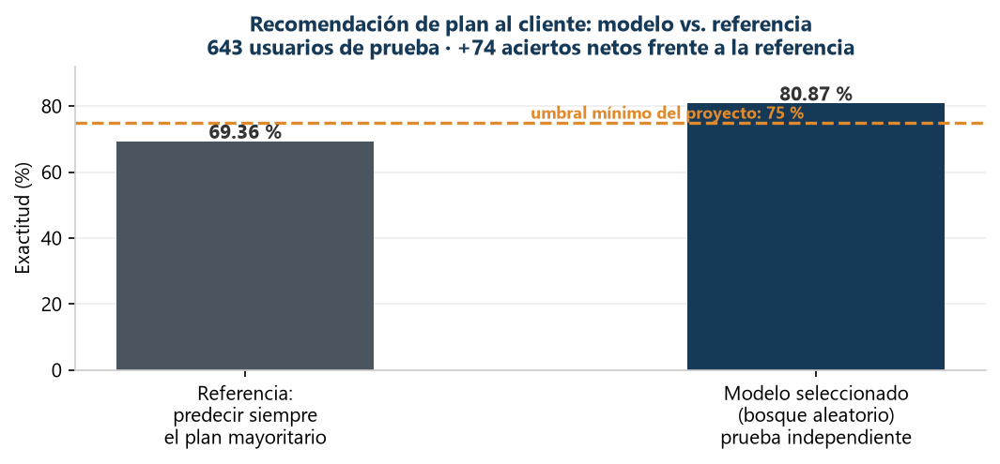

# Recomendación de plan al cliente con machine learning (clasificación)

> **Caso de estudio didáctico** de clasificación supervisada aplicada a negocio: predecir qué plan (Smart o Ultra) corresponde a cada usuario a partir de su comportamiento mensual, para apoyar **recomendaciones comerciales personalizadas**.
>
> Este repositorio documenta **metodología, herramientas, visualización y toma de decisiones** siguiendo buenas prácticas de la industria. El código fuente no se publica (ver [sección 6](#6-nota-sobre-el-código)).

---

## 1. El problema de negocio

Una empresa de telecomunicaciones quiere **recomendar el plan adecuado a cada cliente** según cómo usa llamadas, mensajes e internet. La pregunta de negocio es:

> **¿Podemos predecir el plan que corresponde a cada usuario con suficiente exactitud para automatizar la recomendación comercial?**

Este proyecto construye y compara **39 configuraciones de tres familias de modelos** (árbol de decisión, bosque aleatorio y regresión logística) sobre el comportamiento de **3,214 usuarios**, y evalúa el modelo final en datos nunca utilizados.

---

## 2. El resultado en una gráfica

**Lectura de negocio:**

- El modelo acierta el **80.87 %** en datos de prueba independientes, frente al 69.36 % de simplemente recomendar siempre el plan mayoritario.
- **+74 recomendaciones correctas adicionales** por cada 643 clientes, sin costo comercial adicional.
- Se supera el umbral mínimo del proyecto (75 %) con un margen de **5.87 puntos porcentuales**.

---

## 3. Metodología y buenas prácticas

1. **Calidad de datos** — 3,214 registros y 5 variables de comportamiento; verificación de ausentes y duplicados.
2. **Partición estratificada 60/20/20** — entrenamiento, validación y prueba reproducibles; la prueba no se usa para elegir hiperparámetros.
3. **Comparación controlada** — 39 configuraciones evaluadas con la misma validación; la regresión logística usa un pipeline con estandarización aprendida solo del entrenamiento (sin fuga de información).
4. **Evaluación honesta** — el modelo final se evalúa una sola vez en prueba; se reporta también la referencia de clase mayoritaria como prueba de cordura.
5. **Análisis de errores** — matriz de confusión con lectura de negocio: el modelo reconoce el 92.4 % de los clientes Smart, pero solo el 54.8 % de los Ultra — una limitación cuantificada y declarada.

### Buenas prácticas aplicadas

| Práctica | Cómo se aplicó |
|---|---|
| **Referencia de cordura** | Comparar contra "predecir siempre la clase mayoritaria" antes de afirmar que el modelo aporta valor. |
| **Sin fuga de información** | Estandarización dentro de un pipeline ajustado solo con entrenamiento. |
| **Selección sin tocar la prueba** | Hiperparámetros elegidos por validación; prueba reservada para la evaluación final. |
| **Limitaciones explícitas** | Se reporta el desempeño desigual por clase y se aclara que el objetivo observado es el plan actual, no el óptimo. |

---

## 4. Resultados

| Indicador | Resultado |
|---|---|
| Modelo seleccionado | Bosque aleatorio (100 árboles, profundidad 8) |
| Exactitud de validación | 81.49 % |
| **Exactitud de prueba** | **80.87 %** (520 aciertos de 643) |
| Umbral mínimo exigido | 75 % — **cumplido** |
| Referencia (clase mayoritaria) | 69.36 % |
| **Mejora frente a la referencia** | **+11.51 puntos porcentuales** |

---

## 5. Habilidades demostradas

- **Clasificación supervisada**: árboles de decisión, bosques aleatorios, regresión logística, búsqueda de hiperparámetros.
- **Evaluación rigurosa**: exactitud, matriz de confusión, comparación contra referencia, análisis de errores por clase.
- **Visión de negocio**: traducción de métricas a impacto comercial (recomendaciones correctas adicionales).
- **Comunicación**: resultados y limitaciones explicados para audiencias técnicas y no técnicas.

**Stack técnico:** Python · Pandas · scikit-learn · Matplotlib · Jupyter

---

## 6. Nota sobre el código

El código fuente y los datos no se publican en este repositorio: el proyecto se desarrolló como parte de un programa de formación y el objetivo de este espacio es **documentar el enfoque analítico, los resultados y su valor de negocio**. Con gusto puedo explicar la metodología y las decisiones técnicas en una entrevista o conversación técnica.

---

## Autor

**Cristóbal Antonio Hernández Juárez**
Maestro en Ingeniería Industrial · Doctorante en Finanzas y Empresa · Científico de Datos (TripleTen, en curso)

📍 Poza Rica de Hidalgo, Veracruz, México
📧 crotalushj@gmail.com
🔗 [LinkedIn](https://www.linkedin.com/in/cristóbal-hernández-5201b6277)
